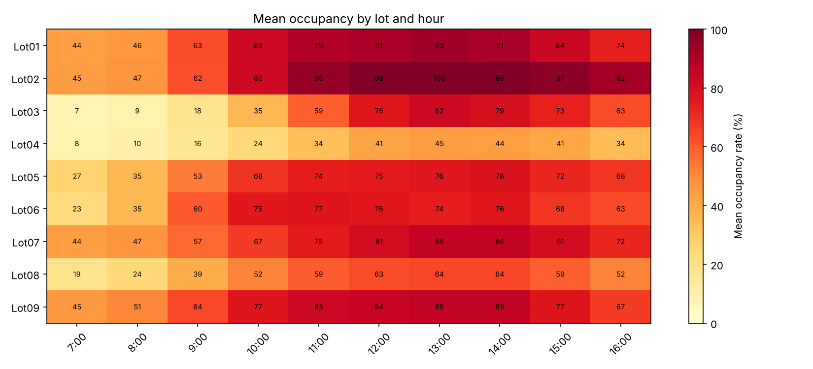
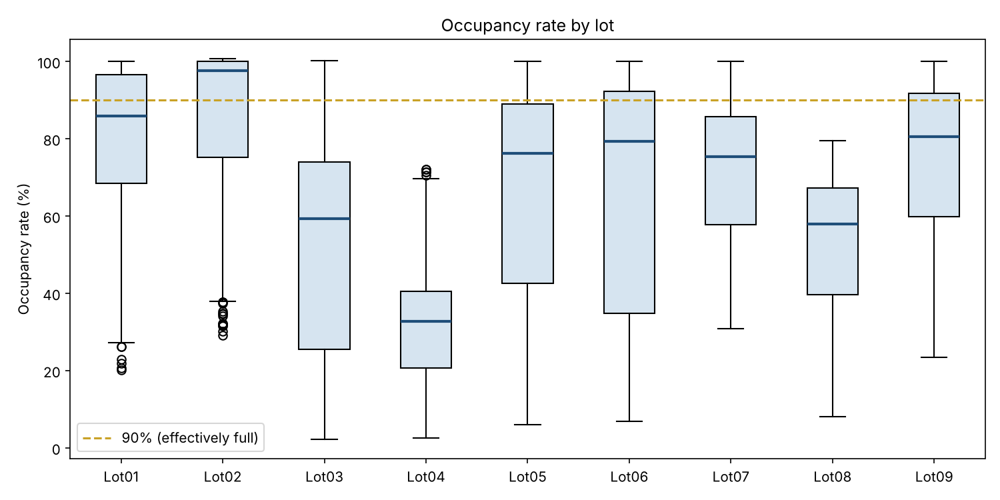

# Parking Occupancy Analysis

Exploratory analysis of 4,138 occupancy readings across nine parking lots over four weeks, built to answer one question for a plaza owner in Bradenton, Florida: is there a parking shortage, or are drivers going to the wrong lots?


## The Business Problem

A plaza owner in Bradenton, Florida was weighing a parking investment. Before spending on new capacity, the owner needed to know where and when demand outruns supply. I worked the data and delivered the findings to the owner.

## Data

`data/parking_occupancy.csv` holds one reading per lot roughly every 30 minutes from 8:00 to 16:30, November 20 to December 17, 2022. See [data/data_dictionary.md](data/data_dictionary.md). Source: plaza parking occupancy data, Bradenton, Florida.

## Results

**Lot by lot**

| Lot | Capacity | Mean rate | Readings at 90%+ | Open spaces, weekday midday |
|---|---|---|---|---|
| Lot02 | 387 | 85.4% | 62.2% | 6 |
| Lot01 | 863 | 78.8% | 42.6% | 33 |
| Lot09 | 720 | 74.0% | 29.4% | 54 |
| Lot07 | 687 | 71.7% | 16.1% | 97 |
| Lot06 | 220 | 66.6% | 30.8% | 22 |
| Lot05 | 470 | 66.1% | 22.3% | 50 |
| Lot03 | 1,194 | 54.0% | 13.1% | 371 |
| Lot08 | 1,200 | 52.3% | 0.0% | 379 |
| Lot04 | 849 | 31.7% | 0.0% | 526 |

**Day of week:** Tuesday through Thursday medians sit near 75 percent. Saturday drops to 53 percent and Sunday to 40 percent.

**Time of day:** every lot peaks in the same 11:00 to 14:00 band, with the network averaging 78 percent at 13:00.





## Findings

1. The shortage is local, not plaza wide. At the weekday midday peak Lot02 averages 6 open spaces while Lots 03, 04, and 08 together hold more than 1,200.
2. Lot02 runs full most of the day and logs readings above its rated capacity.
3. Demand tracks the work week and one shared midday peak.

## Recommendation

Pilot real time availability signs and app guidance that steer drivers from Lots 01 and 02 to Lots 03, 04, and 08 before funding new capacity. Track the share of Lot02 readings above 90 percent as the success measure. The companion repo [parking-demand-mlops](https://github.com/TheSavage007/parking-demand-mlops) turns this data into a forecasting service that could power that guidance.

## Project Structure

```
parking-occupancy-analysis/
├── data/                 raw readings and data dictionary
├── notebooks/            narrated analysis with outputs
├── reports/              summary tables and figures
├── src/eda.py            reusable analysis pipeline
├── tests/                pytest suite with data quality checks
└── .github/workflows/    CI on every push
```

## How to Run

```bash
pip install -r requirements.txt
python src/eda.py --data data/parking_occupancy.csv --out reports
pytest -q
```

## Tech Stack

Python, pandas, NumPy, Matplotlib, Jupyter, pytest, GitHub Actions

## Author

Randy O. Powell | [GitHub](https://github.com/TheSavage007) | [LinkedIn](https://www.linkedin.com/in/randy-powell-224a92bb)
